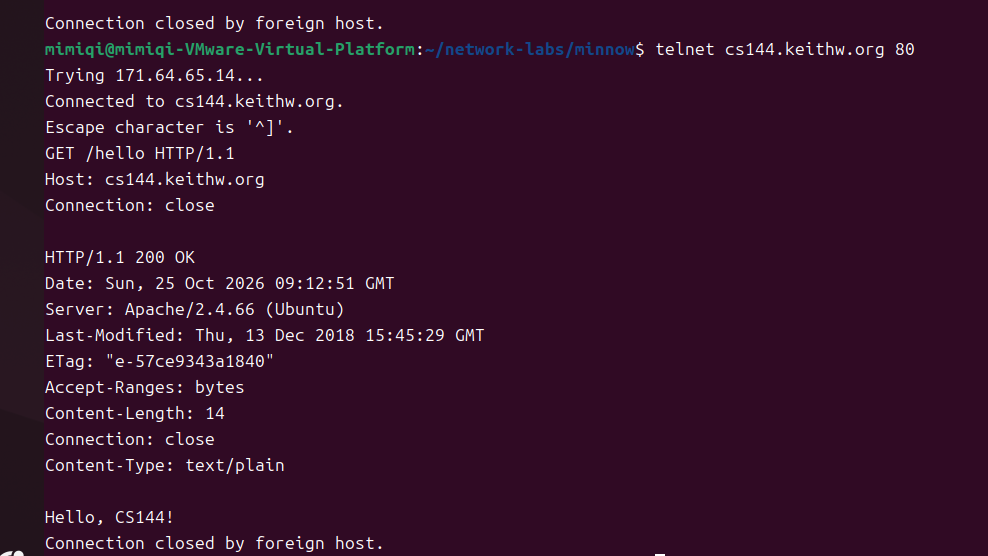
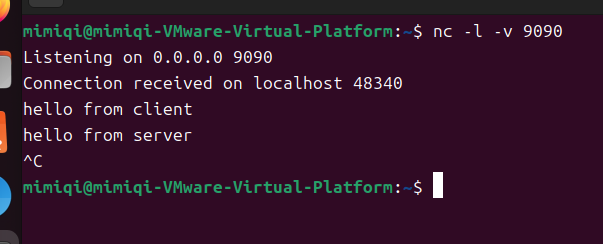
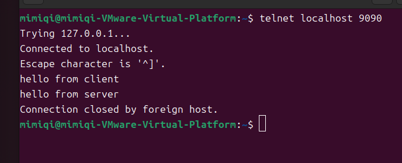
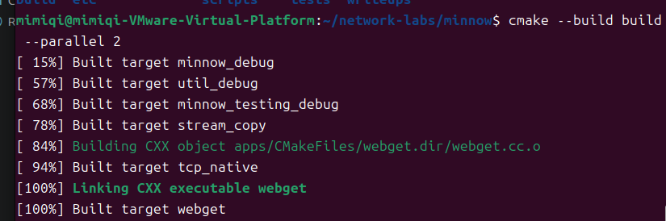
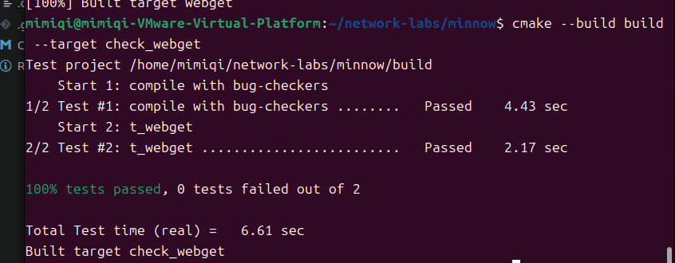

# Checkpoint 0：网络热身实验报告（草稿）

- 课程：计算机网络（CS30066.01）
- 姓名：[待填写]
- 学号：[待填写]
- 实验日期：2026 年 10 月 25 日起
- 当前记录：环境配置、首次编译、手动获取网页及一次 HTTP 400 错误的处理、两个终端之间的双向通信与连接关闭、webget 接口阅读、代码草稿修改、编译及课程测试通过结果。
- 待补充记录：ByteStream 实现与测试、吞吐率。

> 本文根据本次实验中实际提供的终端输出和截图整理，尚不是完整提交稿。后续完成实验后继续补充，并导出为 `report.pdf`。最终要求以[本校实验说明](check0.pdf)和课程后续通知为准。

## 1. 实验目的

1. 配置 Linux 下的 C++ 开发环境，获取并构建课程提供的 Minnow 起始项目。
2. 使用 Telnet 手动发送 HTTP 请求，观察请求、响应和连接关闭过程。
3. 使用两个终端进行双向通信，理解 TCP 提供的字节流服务。
4. 完成 webget 与有容量限制的内存字节流，并通过课程测试与性能检查。

## 2. 实验环境

本次已经确认的环境信息如下：

- 运行环境：VMware 中的 Ubuntu 24.04。
- C++ 编译器：`g++-13`，版本 `13.3.0-6ubuntu2~24.04.1`。
- CMake：`3.28.3`。
- Git：`2.43.0`。
- 编译模式：`Debug`。
- 实验代码目录：`/home/mimiqi/network-labs/minnow`。
- 课程代码来源：`http://10.176.26.200/git/minnow.git`。

版本查询命令：

```bash
g++-13 --version
cmake --version
git --version
```

实际输出节选：

```text
g++-13 (Ubuntu 13.3.0-6ubuntu2~24.04.1) 13.3.0
cmake version 3.28.3
git version 2.43.0
```

以上版本信息来自实际终端输出。其他工具的完整安装日志、虚拟机 CPU/内存和内核版本目前未记录，不据此填写推测值。

## 3. 实验过程与结果

### 3.1 获取课程起始项目

在 Ubuntu 的 `~/network-labs` 目录运行：

```bash
git clone http://10.176.26.200/git/minnow.git
```

实际输出节选：

```text
正克隆到 'minnow'...
remote: Enumerating objects: 72, done.
remote: Counting objects: 100% (72/72), done.
remote: Compressing objects: 100% (66/66), done.
remote: Total 72 (delta 5), reused 0 (delta 0), pack-reused 0
展开对象中: 100% (72/72), 40.13 KiB | 613.00 KiB/s, 完成.
```

克隆成功，说明当时 Ubuntu 能够访问课程校园网 Git 服务。实验实现使用该 Minnow 项目；本报告所在的 Windows 课程资料仓库用于保存说明、截图和报告。

### 3.2 配置与首次编译

进入项目根目录，指定 GCC 13 作为 C++ 编译器：

```bash
cd ~/network-labs/minnow
cmake -S . -B build -DCMAKE_CXX_COMPILER=g++-13
```

实际配置输出节选：

```text
-- The CXX compiler identification is GNU 13.3.0
-- Check for working CXX compiler: /usr/bin/g++-13 - skipped
-- Setting build type to 'Debug'
-- Building in 'Debug' mode.
-- Configuring done (0.2s)
-- Generating done (0.0s)
-- Build files have been written to: /home/mimiqi/network-labs/minnow/build
```

随后执行首次编译：

```bash
cmake --build build --parallel 2
```

实际输出末尾为：

```text
[ 94%] Linking CXX executable webget
[100%] Linking CXX executable tcp_native
[100%] Built target webget
[100%] Built target tcp_native
```

**结果：** CMake 配置和首次编译成功，`webget` 与 `tcp_native` 目标均完成构建。这验证了基本构建环境可用，尚不代表 webget 或 ByteStream 的实验功能已经实现并通过测试。

### 3.3 手动获取网页（讲义 2.1）

#### 3.3.1 首次尝试与问题

在 Ubuntu 中执行：

```bash
telnet cs144.keithw.org 80
```

终端显示已经连接到服务器，但首次输入请求时收到：

```text
HTTP/1.1 400 Bad Request
```

首次终端记录中，`GET /hello HTTP/1.1` 后混入了 `D:\Te`，而 `Host: cs144.keithw.org` 和 `Connection: close` 出现在错误响应之后。

据此判断，问题更可能与请求输入内容或空行位置有关：请求头尚未正确发送完毕，服务器就已经拒绝了请求。由于没有保存首次请求的完整原始字节，不能确定具体哪个按键或粘贴动作是唯一原因。

#### 3.3.2 处理过程

退出失败的会话并重新连接。连接成功后，连续手动输入下面三行，每行按一次回车，三行之间不留空行；第三行结束后，再额外按一次回车发送空行：

```http
GET /hello HTTP/1.1
Host: cs144.keithw.org
Connection: close

```

其中：

- `GET /hello HTTP/1.1` 指定请求方法、资源路径和协议版本。
- `Host` 指明请求的主机。
- `Connection: close` 表示本次响应结束后关闭连接。
- 末尾的空行表示请求头已经发送完毕。

#### 3.3.3 成功结果

重新输入后，实际收到的响应节选如下：

```text
HTTP/1.1 200 OK
Content-Length: 14
Connection: close
Content-Type: text/plain

Hello, CS144!
Connection closed by foreign host.
```



图 1 包含连接建立、完整请求、`200 OK` 状态行、响应头、`Hello, CS144!` 正文以及连接关闭信息。截图为实际终端原图，没有根据文字输出重建或补写内容。

**结果分析：** 服务器成功处理请求并返回正文；最后的连接关闭信息与请求中的 `Connection: close` 相符，属于本次交互的正常结束。此次操作说明，TCP 连接建立后还需要发送格式正确、内容完整的应用层请求，才能获得预期响应。

本节已取得讲义要求的手动获取网页成功截图。浏览器访问同一页面的观察结果目前未记录，后续如补充操作，可在此记录。

### 3.4 监听与终端间通信（讲义 2.2）

在同一台 Ubuntu 虚拟机中打开两个终端，分别作为服务端与客户端，验证本机 TCP 连接中的双向通信及关闭行为。

#### 3.4.1 建立连接

在第一个终端运行服务端：

```bash
nc -l -v 9090
```

服务端显示 `Listening on 0.0.0.0 9090` 后保持运行，在第二个终端启动客户端：

```bash
telnet localhost 9090
```

实际连接结果：

- 客户端显示 `Trying 127.0.0.1...` 和 `Connected to localhost.`。
- 服务端显示 `Connection received on localhost 48340`。
- `9090` 是服务端的监听端口，`48340` 是本次客户端连接使用的端口；再次建立连接时，客户端端口可能变化。

#### 3.4.2 双向发送数据

在客户端输入 `hello from client` 并回车，服务端收到相同文字。随后在服务端输入 `hello from server` 并回车，客户端收到相同文字。

两端的实际截图均保留了上述两行文本。该结果验证了同一条连接可以在两个方向传输数据。

#### 3.4.3 关闭连接

在服务端按 `Ctrl+C` 结束 netcat。服务端截图显示 `^C`，随后返回 shell 提示符；客户端显示 `Connection closed by foreign host.`，也返回 shell 提示符。



图 2 显示服务端监听 `9090` 端口、接受连接、接收客户端消息、输入服务端消息及按 `Ctrl+C` 退出的过程。



图 3 显示客户端连接到 `localhost:9090`、输入客户端消息、接收服务端消息，以及服务端退出后观察到的连接关闭。

**结果分析：** 双向消息均成功到达对端，服务端退出后客户端能够观察到连接结束。本次交互通过终端按回车提交输入；这不意味着 TCP 自带按行划分的消息边界。本阶段已完成连接、双向通信和关闭行为的观察，未出现需要进一步处理的异常。

### 3.5 webget 实现与测试（讲义 3.4，已通过课程测试）

#### 3.5.1 阅读起始代码和接口

先阅读 `apps/webget.cc`，确认 `main()` 已经完成命令行参数检查、读取主机名与路径，以及异常捕获。实际需要补充的是 `get_URL(host, path)`。

随后依次阅读 `util/socket.hh`、`util/file_descriptor.hh` 和 `util/address.hh`，确认：

- `TCPSocket` 继承 `Socket`，可以调用 `connect(const Address&)`。
- `Socket` 继承 `FileDescriptor`，因此 TCP socket 也有 `read`、`write` 和 `eof` 接口。
- `Address` 支持使用主机名与字符串形式的服务名构造目标地址；本次使用 `host` 与 `"http"`。
- `write()` 返回实际写入的字节数，类型为 `size_t`。
- `read(std::string&)` 返回 `void`，通过引用参数把读取到的数据带回。
- `eof()` 返回读取结束标志，接收时需要持续读取直到 EOF。

#### 3.5.2 当前实现思路

在 `apps/webget.cc` 的 `get_URL()` 中逐步编写正常收发流程：

1. 创建 `TCPSocket`，连接主机的 HTTP 服务。
2. 使用传入的 `path` 和 `host` 拼接 HTTP 请求，包含请求行、Host、`Connection: close`，以 `\r\n\r\n` 结束请求头。
3. 用 `size_t` 计数器记录已经发送的字节数。每次写入尚未发送的后缀，再按 `write()` 返回的实际写入量推进，直到请求全部发送。
4. 接收循环中创建字符串，通过 `read()` 接收数据，再原样输出到 `cout`，直到读到 EOF；输出不额外添加换行。

本阶段代码先覆盖正常收发流程，写入零进展等额外异常分支未纳入本阶段实现与验证。

#### 3.5.3 代码草稿检查与修正

本次草稿中实际出现并处理了以下问题：

- 起初将主机名和服务名直接作为两个参数传给 `connect()`；查阅接口后，改为先构造一个 `Address` 对象再传入。
- 请求字符串初始化行末遗漏分号，Host 行末误写为普通字符 `/r/n`；修正为正确的语句结束符与 `\r\n` 行结束符，并移除 Host 值末尾多余的空格。
- 起初把 `size_t` 当作变量名，使用 `sizeof(request)` 判断请求长度；随后区分类型与变量名，并改用 `request.size()` 获取字符串长度。
- 起初未通过 socket 对象调用 `write()`，且每轮只将发送计数加一；随后改为调用 `tcp_socket.write()`，按实际写入字节数累加。
- 中间草稿曾混用 `size` 和 `sent` 两个计数变量名；随后统一名称，并将 `written` 的类型与接口返回值统一为 `size_t`。
- 起初不清楚如何接收数据；确认 `read()` 不返回字符串后，采用“声明字符串、调用 `read()`、输出字符串”的顺序补全接收循环。

这些是编译前根据代码草稿进行的检查与修正。本报告没有相应草稿的实际编译失败日志，因此不把这些问题写成已经观察到的编译报错或测试失败。

上述过程中使用了 AI 的接口解释、局部修正建议和接收循环示例；具体辅助情况见第 5 节。

#### 3.5.4 修改后的编译结果

保存修改后，在 Minnow 项目根目录运行：

```bash
cmake --build build --parallel 2
```

实际输出节选：

```text
[ 84%] Building CXX object apps/CMakeFiles/webget.dir/webget.cc.o
[ 94%] Built target tcp_native
[100%] Linking CXX executable webget
[100%] Built target webget
```



图 4 显示 `webget.cc` 被重新编译、链接，并最终生成 `webget` 目标。当前已经确认修改后的项目能够完成构建。

#### 3.5.5 课程测试结果

编译成功后，在 Minnow 项目根目录执行：

```bash
cmake --build build --target check_webget
```

实际测试结果：

- 测试目录：`/home/mimiqi/network-labs/minnow/build`。
- `compile with bug-checkers`：通过，耗时 `4.43 sec`。
- `t_webget`：通过，耗时 `2.17 sec`。
- 本次测试共 2 项，全部通过，失败 0 项；总实际耗时 `6.61 sec`。

输出中的最终结论为：

```text
100% tests passed, 0 tests failed out of 2

Total Test time (real) = 6.61 sec
Built target check_webget
```



图 5 包含执行命令、测试项目名称、各项目的通过状态和耗时，以及最终汇总。该图是本次实际测试的原始截图，作为讲义要求的 webget 测试通过证据。

**结果分析：** 当前 webget 实现已经通过本次 `check_webget` 目标包含的两项测试，完成这一阶段的课程验证。该结论对应本次代码和环境下的实际结果；ByteStream 的功能与吞吐率仍需在下一阶段单独验证。

### 3.6 ByteStream 实现、测试与性能（讲义第 4 节，待补充）

尚无本阶段的实现、测试或性能测量记录。

待补充：

- 实际采用的数据结构及选择原因。
- 如何处理容量限制、读取与移除、关闭后读尽、累计字节计数。
- 实际出现的边界错误、定位方法和修复过程；没有发生的问题不编造成调试经历。
- 自动测试的实际结果。
- 吞吐率的实测值和完整输出截图。

后续在 Minnow 项目根目录执行：

```bash
cmake --build build --target check0
```

课程要求 ByteStream 吞吐率**超过 0.1 Gbit/s**。当前没有实测值，不填写通过数量、吞吐率或评分。

## 4. 当前阶段的认识与后续工作

本阶段已经完成工具版本确认、课程代码获取、CMake 配置与首次编译、一次成功的手动 HTTP 请求，以及两个终端之间的双向通信和连接关闭观察。随后阅读 Minnow 的相关接口，逐步编写和修改 webget 的正常收发流程，成功重新编译，并通过 `check_webget` 的全部两项测试。HTTP 400 的处理过程表明，请求内容与空行位置会直接影响服务器对请求的解析；本机通信实验验证了同一条 TCP 连接能够双向传送数据。

接下来开展 ByteStream 实现，继续记录实际的实现选择与调试过程，补齐自动测试和吞吐率截图。当前仍需取得 ByteStream 的测试与性能结果，完成后再整理和检查最终报告。

## 5. 资料与辅助工具使用记录

- 实验任务、结果截图要求、评分和提交方式依据[本校 Checkpoint 0 实验说明](check0.pdf)。
- 本次使用 AI 辅助核对讲义、解释环境配置命令、分析终端输出并整理报告草稿。实验命令由本人在 Ubuntu 中执行；本文中的实际结果来自本人提供的终端输出与截图。
- 在 webget 编写过程中，本人先提供函数草稿，AI 协助解释接口、检查类型与变量、请求格式及发送计数问题，并提供了局部修正和接收循环示例；本人据此在 Ubuntu 中调整代码并重新编译。写入零进展异常处理建议本阶段未采用。
- ByteStream 尚无实现记录；后续继续如实记录本人实际编写过程、参考资料和辅助工具使用情况。
- 提交前逐项核对本文，保留本人能够解释的真实操作与结果，删除尚未完成的占位说明，不使用预期结果代替实际结果。

## 附：报告与提交要求备忘

本节依据本校讲义第 1、2、10 页整理，供完成实验后逐项核对。

- 最终报告文件名为 `report.pdf`；Markdown 是本地可编辑草稿，需在实验完成后导出 PDF。
- 没有固定页数要求，也没有固定的实验过程记录形式；重点是过程完整，体现实际思考、操作和调试，不堆砌大量源代码。
- 必须包含三类成功截图：手动获取网页、webget 测试、ByteStream 测试。
- ByteStream 需要通过课程测试，吞吐率超过 `0.1 Gbit/s`。
- 不需要另交 writeup；提交包内包含 `minnow/` 与 `report.pdf`。
- 提交代码的修改范围按讲义限制在 `apps/webget.cc`、`src/byte_stream.hh` 和 `src/byte_stream.cc`，保留测试与 `util` 辅助代码。
- 提交前按讲义运行格式化并重新测试；`tidy` 在提交章节中列为可选。格式化若修改了文件，也应纳入最终 Git 提交，并检查工作区状态。
- 打包时移除提交副本中的 `minnow/build/`，保留源码和报告；本次草稿整理没有删除实验构建目录。
- 压缩包文件名为 `学号-姓名-check0.tar.gz`。在 `minnow/` 与 `report.pdf` 的共同父目录执行：

  ```bash
  tar -czvf 学号-姓名-check0.tar.gz minnow report.pdf
  ```

- 正常截止：2026 年 10 月 28 日 23:59；补交截止：2026 年 11 月 4 日 23:59，补交按批改分数的 0.7 计算。日期按北京时间记录，如课程后续通知有变动，以通知为准。

### 完成情况清单

- [x] 记录 Ubuntu、GCC、CMake、Git 版本。
- [x] 获取课程 Minnow 并完成首次构建。
- [x] 记录一次 HTTP 400 错误及处理过程。
- [x] 保存并插入手动获取网页的真实成功截图。
- [ ] 补充浏览器访问同一页面的观察。
- [x] 记录两个终端之间的双向通信与关闭行为，并保存两端的真实截图。
- [x] 记录 webget 接口阅读、代码草稿检查与编译成功截图。
- [x] 运行 webget 课程测试，记录全部 2 项通过的实际结果并保存测试通过截图。
- [ ] 补齐 ByteStream 的本人实现过程、测试通过截图及吞吐率。
- [ ] 填写姓名、学号并审阅全部过程记录。
- [ ] 完成格式化、最终测试和 Git 状态检查。
- [ ] 导出并检查 `report.pdf`，确认图片可见、文字清晰。
- [ ] 核对提交包内容，确保不包含 `minnow/build/`。
