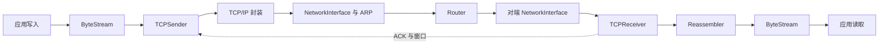

# Minnow 配套实验：中文解题讲解与资料

整理日期：2026-10-22。内容形式：逐实验中文解题讲解＋公开参考实现链接。

本目录按 **Winter 2024 Minnow 的 Checkpoint 0—7** 编排，覆盖字节流、重组、TCP 收发、真实网络互通与测量、ARP、路由和端到端联调。解题讲解是依据资料整理的学习参考，不是课程发布的标准答案，也不是已经在本校环境通过测试的实现。

本校目前可对照的讲义只有 [check0.pdf](../check0/check0.pdf)。其中提及六部分实验，但尚无后续讲义可确认编号；这里的八章覆盖公开配套内容，不能据此认定本校也要求八次提交。先读 [版本与编号对照](00_版本与编号对照.md)。

## 全套目录

| 阶段 | 中文讲解 | 核心产物或能力 |
| --- | --- | --- |
| Checkpoint 0 | [网络热身](check0_网络热身.md) | HTTP 客户端、有界字节流 |
| Checkpoint 1 | [流重组器](check1_流重组器.md) | 乱序、重叠片段恢复为连续字节流 |
| Checkpoint 2 | [TCP 接收方](check2_TCP接收方.md) | 序列号回绕、ACK、接收窗口 |
| Checkpoint 3 | [TCP 发送方](check3_TCP发送方.md) | 分段、窗口、确认、超时重传 |
| Checkpoint 4 | [真实网络互通与测量](check4_真实网络互通与测量.md) | 用自己的 TCP 获取网页，分析路径数据 |
| Checkpoint 5 | [网络接口与 ARP](check5_网络接口与ARP.md) | IPv4 与以太网之间的封装及地址解析 |
| Checkpoint 6 | [IP 路由器](check6_IP路由器.md) | 最长前缀匹配、TTL、下一跳转发 |
| Checkpoint 7 | [端到端联调](check7_端到端联调.md) | 主机与路由器联合通信、文件完整性验证 |

公共入口：

- [资料来源与参考实现](资料来源与参考实现.md)：完整讲义链接、原作者实验记录、两份参考实现的固定提交链接。
- [实验环境与验证清单](实验环境与验证清单.md)：换电脑后的阅读、环境确认、测试和报告记录顺序。
- [Checkpoint 0 专题资料](../check0/examples/README.md)：已整理的 HTTP、C++、构建和调试基础。

## 模块怎么连接

这是逻辑数据路径示意；课程框架负责部分 TCP/IP 胶合、调度及虚拟网络设备接入。每个方向都有各自的发送与接收状态。

## 如何使用这份“答案”

先用中文讲解推演输入、状态和输出，再核对自己 starter 的头文件与测试，最后需要时打开参考实现比较设计。文中的手算例子是说明性样例；性能、ping 数据、截图、文件哈希和实验是否成功，都需要在真实实验中记录。

本次已核验来源版本和参考文件路径，未运行参考实现，也没有把第三方源码复制进本项目。原文及参考实现通过固定链接访问；中文笔记可以离线阅读。
