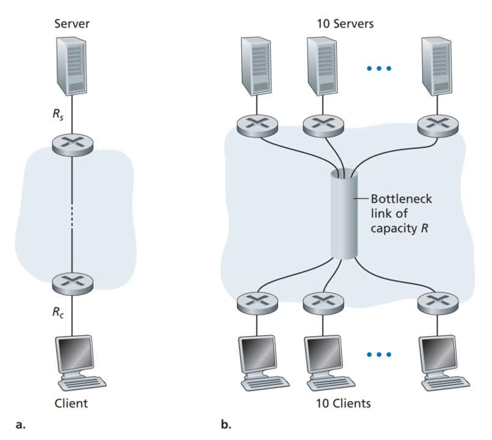
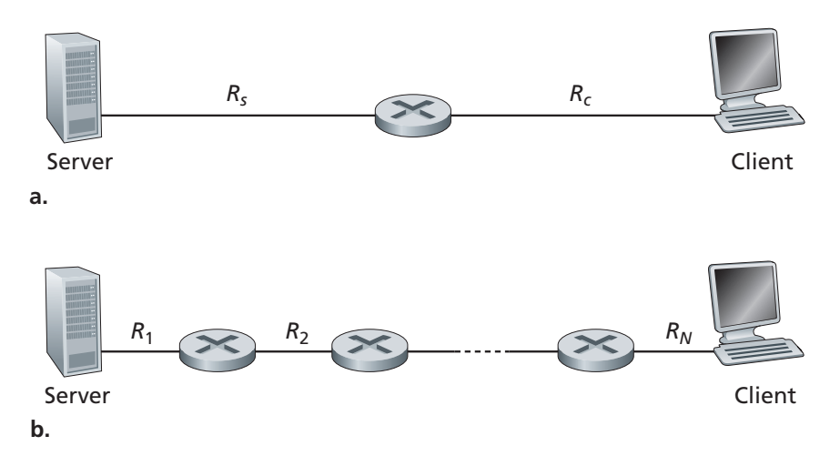
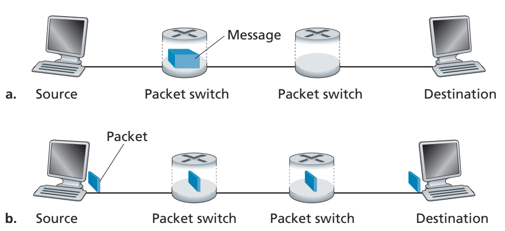

# 计算机网络作业二：题干翻译

原题：[Homework_2.pdf](Homework_2.pdf)。保留原题题号、变量、数值及全部 3 幅配图；图中文字沿用原图，图注译为中文。

## P2-1

考虑图 2.1(b) 对应的吞吐量示例。现在假设有 $M$ 对客户机与服务器，而不是 10 对。用 $R_s$、$R_c$ 和 $R$ 分别表示服务器接入链路、客户机接入链路和网络中共享链路的传输速率。假设其他所有链路的容量都足够大，而且网络中除了这 $M$ 对客户机与服务器产生的流量之外，没有其他流量。

请用 $R_s$、$R_c$、$R$ 和 $M$ 推导吞吐量的一般表达式。

*图 2.1　端到端吞吐量：(a) 客户机从服务器下载文件；(b) 10 台客户机分别从 10 台服务器下载文件。图中的 Bottleneck link of capacity R 表示容量为 $R$ 的瓶颈链路。*

## P2-2

考虑图 2.2(b)。现在假设服务器与客户机之间有 $M$ 条路径，任意两条路径都不共享链路。第 $k$ 条路径（$k=1,\ldots,M$）由 $N$ 条链路组成，其传输速率分别为

$$
R_1^k,\ R_2^k,\ \ldots,\ R_N^k.
$$

如果服务器只能使用其中一条路径向客户机发送数据，它能够达到的最大吞吐量是多少？如果服务器可以使用全部 $M$ 条路径发送数据，它能够达到的最大吞吐量又是多少？

*图 2.2　服务器向客户机传输文件时的吞吐量：(a) 两条链路，速率分别为 $R_s$ 和 $R_c$；(b) 由 $N$ 条链路组成的路径。Server 为服务器，Client 为客户机。*

## P2-3

考虑图 2.2(a)。假设已知从服务器到客户机的路径中，第一条链路是瓶颈链路，其速率为 $R_s$ bit/s。服务器向客户机背靠背地发送两个分组，并且该路径上没有其他流量。每个分组的长度均为 $L$ bit，两条链路的传播时延均为 $d_{\mathrm{prop}}$。

**(a)** 目的端两个分组的到达时间间隔是多少？也就是说，从第一个分组的最后一个比特到达，到第二个分组的最后一个比特到达，经过了多长时间？

**(b)** 现在假设第二条链路是瓶颈链路，即 $R_c<R_s$。第二个分组是否可能在第二条链路的输入队列中排队？请解释。再假设服务器在发送第一个分组后，过了 $T$ 秒才发送第二个分组。为了保证第二个分组在第二条链路之前不发生排队，$T$ 至少需要多大？请解释。

## P2-4

假设你需要紧急地将 50 TB 数据从北京送到上海。你有一条可用于传输数据的 100 Mbps 专用链路。你会选择通过这条链路传输数据，还是使用顺丰快递的隔夜送达服务？请说明理由。

其中，$1\ \mathrm{TB}=10^{12}\ \mathrm{byte}$。

## P2-5

在包括互联网在内的现代分组交换网络中，源主机会将较长的应用层报文（例如一张图片或一个音乐文件）分割成较小的分组，再将这些分组发送到网络中。接收方随后将分组重新组装成原始报文。这个过程称为**报文分段（message segmentation）**。图 2.3 展示了采用和不采用报文分段时，报文的端到端传输过程。

考虑图 2.3 中从源主机发送到目的主机的一份长度为 $10^6$ bit 的报文。图中每条链路的速率均为 5 Mbps。忽略传播时延、排队时延和处理时延。

**(a)** 不对报文进行分段，直接从源主机发送到目的主机。将整份报文从源主机传输到第一台分组交换机需要多长时间？注意，每台交换机都采用存储转发分组交换。将整份报文从源主机传输到目的主机的总时间是多少？

**(b)** 现在将报文分成 100 个分组，每个分组长 10,000 bit。将第一个分组从源主机传输到第一台交换机需要多长时间？当第一台交换机将第一个分组发送到第二台交换机时，源主机同时将第二个分组发送到第一台交换机。第一台交换机在什么时刻完整接收到第二个分组？

**(c)** 采用报文分段时，将整个文件从源主机传输到目的主机需要多长时间？将这个结果与 (a) 的答案比较，并说明原因。

*图 2.3　报文的端到端传输：(a) 不采用报文分段；(b) 采用报文分段。Source 为源主机，Destination 为目的主机，Packet switch 为分组交换机，Message 为报文，Packet 为分组。*

## P2-6

考虑将一个长度为 $F$ bit 的大文件从主机 A 发送到主机 B。A 与 B 之间有三条链路和两台交换机，所有链路均不拥塞，即没有排队时延。主机 A 将文件划分成每段 $S$ bit，并在每段前添加 80 bit 的首部，形成长度为 $L=S+80$ bit 的分组。每条链路的传输速率均为 $R$ bit/s。

忽略传播时延。求使整个文件从主机 A 传输到主机 B 的时延最小的 $S$。

## P2-7

Skype 提供一种允许用户从个人计算机（PC）拨打普通电话的服务。这意味着语音通话必须同时经过互联网和电话网络。请讨论这种服务可能如何实现。
