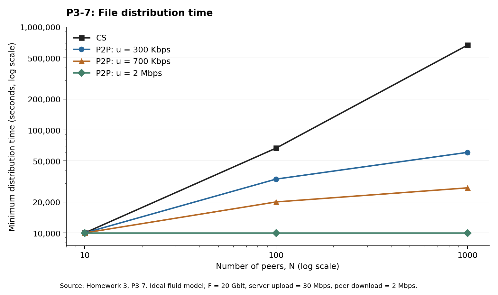

# 计算机网络作业三

> 状态：待审阅。本文件为中文答案草稿；只有在用户审阅批准后，才转换为答案 PDF。

题目见 [中文题干](Homework_3_题干翻译.md) 和 [原题 PDF](Homework_3.pdf)。以下采用题目中的经典 HTTP/1.1、TCP 与理想流体分发模型。P3-4、P3-5 假设最初没有已建立的 TCP 连接，忽略题目未计入的处理时间与连接关闭时间。

## P3-1

**(a) 错误。** 在没有缓存、每个对象均需获取的通常情形下，HTML 文件和三幅图像共 4 个对象，需要 **4 条请求报文和 4 条响应报文**。客户机先请求 HTML，再根据 HTML 中的引用分别请求三幅图像。

**(b) 正确。** 持久连接允许复用同一条 TCP 连接，依次传送同一服务器上多个对象的 HTTP 请求和响应；题目中的两个页面可以通过同一条持久连接传送。

**(c) 错误。** 非持久 HTTP 每条 TCP 连接只传送一组请求与响应。一个 TCP 报文段属于一条特定的 TCP 连接，不能把不同连接上的两条 HTTP 请求合并在一起。

**(d) 错误。** `Date` 表示响应报文的生成时间；对象最后修改时间应由 `Last-Modified` 表示。

**(e) 错误。** HTTP 响应可以没有报文体，例如 `HEAD` 请求的响应，以及 `204 No Content`、`304 Not Modified` 响应。

依据：[RFC 9110 的响应语义与 Date 定义](https://www.rfc-editor.org/rfc/rfc9110.html#section-6.6.1)、[RFC 9112 的持久连接规定](https://www.rfc-editor.org/rfc/rfc9112.html#section-9.3)。

## P3-2

### (a) 文档 URL

请求行为 `GET /cs453/index.html HTTP/1.1`，其中给出路径；`Host: gaia.cs.umass.edu` 给出服务器主机名。按本题普通 HTTP 的语境，文档 URL 为：

```text
http://gaia.cs.umass.edu/cs453/index.html
```

### (b) HTTP 版本

**HTTP/1.1**，依据请求行末尾的 `HTTP/1.1`。

### (c) 连接类型

**持久连接**，依据 `Connection:keep-alive`。另外，HTTP/1.1 本身默认使用持久连接，除非通过 `Connection: close` 等方式表明要关闭连接。

### (d) 浏览器所在主机的 IP 地址

**仅凭题目给出的 HTTP 请求报文无法确定。** 其中没有客户机 IP 地址；`Host` 是目标服务器的主机名。若查看 Wireshark 捕获的完整分组，应读取承载该请求的 IP 首部中的源 IP 地址，而不能从 `Host` 推断。

### (e) 浏览器类型及其用途

浏览器是 **Netscape 7.2**，依据 `User-Agent` 中的 `Netscape/7.2`。同一字段还给出了 Windows NT 5.1、Gecko 等信息；不能仅凭兼容性标识 `Mozilla/5.0` 就把它认作其他浏览器。

服务器可以据此识别客户机软件并处理兼容性差异，例如选择适合该浏览器的页面内容。这是发送浏览器类型的用途，**并非 HTTP 请求在语法上必须具备该字段才能成立**。[RFC 9110 §10.1.5](https://www.rfc-editor.org/rfc/rfc9110.html#section-10.1.5)

## P3-3

### (a) 是否成功、响应生成时间

**成功找到并返回了文档**，依据状态行 `HTTP/1.1 200 OK`。

响应生成时间取自：

```text
Date: Tue, 07 Mar 200812:39:45GMT
```

按题面给出的年月日和时分秒解读，为 **2008 年 3 月 7 日 12:39:45 GMT**。

注意：原题的日期字符串缺少必要空格，且 `Tue` 与 2008 年 3 月 7 日实际为星期五不一致，因此它不是格式和取值均正确的 HTTP 日期。这里保留原题数值，不擅自把年份改成其他年份；`Date` 也不表示客户机收到响应的时刻。

### (b) 最后修改时间

依据：

```text
Last-Modified: Sat, 10 Dec2005 18:27:46GMT
```

按题面解读，为 **2005 年 12 月 10 日 18:27:46 GMT**。该字段同样存在空格缺失。

### (c) 文档字节数

**3874 byte**，依据 `Content-Length: 3874`。这是返回文档的长度，不包括 HTTP 状态行和首部。

### (d) 前 5 个字节及连接类型

首部由空行结束，即 `<cr><lf><cr><lf>` 之后才是文档内容。文档以 `<!doctype ...` 开头，因此前 5 个字节为：

```text
<!doc
```

服务器**同意持久连接**，依据 `Connection: Keep-Alive`。判断不依赖题面中格式可疑的 `Keep-Alive: timeout=max=100`。

字段含义依据：[RFC 9110 的 Date](https://www.rfc-editor.org/rfc/rfc9110.html#section-6.6.1)、[Last-Modified](https://www.rfc-editor.org/rfc/rfc9110.html#section-8.8.2)、[Content-Length](https://www.rfc-editor.org/rfc/rfc9110.html#section-8.6)。

## P3-4

DNS 查询依次访问 $n$ 台服务器，总时间为

$$
T_{\mathrm{DNS}}=\sum_{i=1}^{n}\mathrm{RTT}_i.
$$

获得服务器 IP 地址后，建立 TCP 连接需要 $1\mathrm{RTT}_0$；发送 HTTP 请求并收到对象需要再经过 $1\mathrm{RTT}_0$。对象传输时间按题设为零，因此

$$
\boxed{T=\sum_{i=1}^{n}\mathrm{RTT}_i+2\mathrm{RTT}_0}.
$$

## P3-5

记 $D=\sum_{i=1}^{n}\mathrm{RTT}_i$，$r=\mathrm{RTT}_0$。总共需要获取 **1 个基础 HTML 对象和 8 个引用对象，共 9 个对象**。引用对象都在同一台服务器上，因此只计一次 DNS 查询。

### (a) 非持久 HTTP，不并行

每个对象分别建立 TCP 连接，耗费 $1r$；随后请求并接收对象，再耗费 $1r$。9 个对象依次获取，因此

$$
\boxed{T_a=D+9\times2r=D+18r}.
$$

### (b) 非持久 HTTP，最多 6 条并行连接

首先获取基础 HTML，耗费 $2r$。解析出 8 个引用对象后，需要 $\lceil8/6\rceil=2$ 轮下载：第一轮下载 6 个，第二轮下载剩余 2 个。每轮均包含建立连接与请求响应，耗费 $2r$，所以

$$
\boxed{T_b=D+2r+2\times2r=D+6r}.
$$

### (c) 持久 HTTP

**若使用持久连接并进行流水线请求：**获取基础 HTML 共耗费 $2r$；随后在同一条 TCP 连接上连续发出 8 条请求，不必逐一等待响应。忽略对象传输时间，8 个引用对象可在再经过 $1r$ 后收到，因此

$$
\boxed{T_{c,\mathrm{pipeline}}=D+3r}.
$$

**若持久连接不采用流水线，逐个请求并等待响应：**TCP 连接只建立一次，但 8 个引用对象仍各需 $1r$，因此

$$
\boxed{T_{c,\mathrm{no\ pipeline}}=D+2r+8r=D+10r}.
$$

原题只写了“持久 HTTP”，未说明流水线。按通常考查流水线持久 HTTP 的口径，主答案取 $D+3r$；若课程要求非流水线持久 HTTP，则取 $D+10r$。持久连接本身不必然意味着流水线。[RFC 9112 §9.3.2](https://www.rfc-editor.org/rfc/rfc9112.html#section-9.3.2)

## P3-6

**并行的非持久 HTTP 不能显著缩短下载时间；持久 HTTP 的收益也很有限。** 本题主要耗时来自低速链路上的数据传输。

### 数据与控制分组的时间量级

每个对象长 $L=100\times10^3=100{,}000$ bit，链路速率 $R=150$ bit/s。单个对象占用整个下载方向带宽时，传输时间为

$$
t_{\mathrm{data}}=\frac{100{,}000}{150}\approx666.67\ \mathrm{s}.
$$

一个纯控制分组的传输时间为

$$
t_{\mathrm{ctrl}}=\frac{200}{150}\approx1.33\ \mathrm{s}.
$$

10 米链路的传播时间相对于这些传输时间可以忽略。一个数据分组的长度是控制分组的 **500 倍**。

### 并行的非持久 HTTP

基础对象先下载，之后才能知道它引用的 10 个对象。若这 10 个对象并行下载，每条连接只获得 $150/10=15$ bit/s，因此每个对象需要

$$
\frac{100{,}000}{15}\approx6666.67\ \mathrm{s}.
$$

10 个引用对象依次下载所需的数据传输时间同样为

$$
10\times\frac{100{,}000}{150}\approx6666.67\ \mathrm{s}.
$$

所以并行不能提高题设规定的总带宽，也不能减少主要的数据传输时间。包括基础对象在内，11 个对象的数据传输时间下界为

$$
\boxed{T_{\mathrm{data}}=11\times\frac{100{,}000}{150}
\approx7333.33\ \mathrm{s}\approx122.22\ \mathrm{min}}.
$$

并行也没有省掉各条非持久连接的握手，最多只能改变少量控制操作与数据传输的重叠关系，因此在本题中没有明显的性能优势。

### 持久 HTTP

持久连接可以复用一次建立的 TCP 连接，省去其余 10 次建连及相应的部分控制开销。但是它仍必须传送全部 $1{,}100{,}000$ bit 对象数据。节省的控制开销相对于约 7333 秒的数据传输时间较小，**不会带来显著提升**。

上述 7333.33 秒仅是数据传输时间，不是包含握手、请求、确认和关闭连接的精确总耗时；题目没有给出这些控制报文如何合并或重叠的完整规则。

## P3-7

统一使用十进制单位：

$$
F=20\times10^9\ \mathrm{bit},\quad
u_s=30\times10^6\ \mathrm{bit/s},\quad
d_{\min}=2\times10^6\ \mathrm{bit/s}.
$$

### 最短分发时间公式

客户机-服务器方式中，服务器必须上传 $N$ 份文件，最慢的客户机也必须完整下载一份，因此

$$
\boxed{D_{\mathrm{CS}}=\max\left\{\frac{NF}{u_s},\frac{F}{d_{\min}}\right\}}.
$$

P2P 方式中，服务器至少要上传一份完整文件；每个对等方都要完整下载；所有 $N$ 个对等方总共需要接收 $NF$ bit，而系统总上传能力为 $u_s+Nu$。因此在本题理想流体模型下，采用

$$
\boxed{D_{\mathrm{P2P}}=\max\left\{\frac{F}{u_s},\frac{F}{d_{\min}},\frac{NF}{u_s+Nu}\right\}}.
$$

这里将课件中的容量下界作为理想模型下可达到的最短时间，不计分块启动、协议开销、重传与对等方离线。公式与课程课件 [2 App layer1.pdf](../2%20App%20layer1.pdf) 的 PDF 第 86、87 页一致。

公共项为

$$
\frac{F}{u_s}=666.666\ldots\ \mathrm{s},\qquad
\frac{F}{d_{\min}}=10{,}000\ \mathrm{s},\qquad
\frac{NF}{u_s}=666.666\ldots N\ \mathrm{s}.
$$

### 全部 9 种组合

下表单位均为 **秒**，非整数结果四舍五入到小数点后两位。

| 对等方数量 $N$ | 每个对等方上传速率 $u$ | 客户机-服务器 $D_{\mathrm{CS}}$（s） | P2P $D_{\mathrm{P2P}}$（s） |
| ---: | ---: | ---: | ---: |
| 10 | 300 Kbps | 10,000 | 10,000 |
| 10 | 700 Kbps | 10,000 | 10,000 |
| 10 | 2 Mbps | 10,000 | 10,000 |
| 100 | 300 Kbps | 66,666.67 | 33,333.33 |
| 100 | 700 Kbps | 66,666.67 | 20,000 |
| 100 | 2 Mbps | 66,666.67 | 10,000 |
| 1000 | 300 Kbps | 666,666.67 | 60,606.06 |
| 1000 | 700 Kbps | 666,666.67 | 27,397.26 |
| 1000 | 2 Mbps | 666,666.67 | 10,000 |



*横轴为对等方数量，纵轴为最短分发时间（秒，采用对数刻度）；各曲线按上式计算。图中标签使用英文缩写，CS 表示客户机-服务器方式。*

例如，$N=1000$、$u=300$ Kbps 时，总上传速率为 $30+1000\times0.3=330$ Mbps，故

$$
D_{\mathrm{P2P}}=
\max\left\{666.67,10{,}000,
\frac{1000\times20\times10^9}{330\times10^6}\right\}
=60{,}606.06\ \mathrm{s}.
$$

当 $N=10$ 时，两种方式都受到每个对等方 2 Mbps 下载速率的限制。随着 $N$ 增大，客户机-服务器方式主要受服务器总上传速率限制；P2P 能利用新增对等方的上传能力，因此扩展性更好。

## P3-8

令 $d_{\min}=\min_i d_i$，并假设 $N\geq1$、$u_s>0$、$d_{\min}>0$。

### (a) $u_s/N\leq d_{\min}$

服务器从开始时刻起，同时向所有 $N$ 个对等方发送文件，给每个对等方分配恒定速率

$$
r_i=\frac{u_s}{N}.
$$

总速率为 $\sum_i r_i=u_s$，满足服务器上传约束；又因为 $r_i\leq d_{\min}\leq d_i$，每个对等方都能接收。所有对等方同时完成下载，时间为

$$
\boxed{D=\frac{F}{u_s/N}=\frac{NF}{u_s}}.
$$

### (b) $u_s/N\geq d_{\min}$

服务器同时以相同速率

$$
r_i=d_{\min}
$$

向每个对等方发送文件。此时 $\sum_i r_i=Nd_{\min}\leq u_s$，且 $r_i\leq d_i$，满足所有约束。所有对等方在

$$
\boxed{D=\frac{F}{d_{\min}}}
$$

时完成下载。较快对等方无需占满自身下载带宽，因为最慢对等方已经决定了整体完成时间。

### (c) 证明一般公式

任意方案均必须满足两个下界：服务器至少上传 $NF$ bit，故 $D\geq NF/u_s$；最慢对等方至少下载 $F$ bit，故 $D\geq F/d_{\min}$。因此

$$
D\geq\max\left\{\frac{NF}{u_s},\frac{F}{d_{\min}}\right\}.
$$

当 $u_s/N\leq d_{\min}$ 时，$NF/u_s\geq F/d_{\min}$，(a) 的方案达到较大的那个下界；当 $u_s/N\geq d_{\min}$ 时，$F/d_{\min}\geq NF/u_s$，(b) 的方案达到较大的那个下界。两种情形涵盖所有情况，因此

$$
\boxed{D_{\min}=\max\left\{\frac{NF}{u_s},\frac{F}{d_{\min}}\right\}}.
$$

## P3-9

本题以教材常见的 Python socket 客户机/服务器为前提：TCP 客户机调用 `connect()` 后收发数据；UDP 客户机调用 `sendto()`，再通过 `recvfrom()` 等待响应。下述讨论假设目标主机可达，指定端口没有其他同类服务占用。

### (a) 先运行 TCPClient

如果客户机连接时服务器尚未监听目标 TCP 端口，目标主机通常会返回 TCP RST，客户机的 `connect()` 失败，表现为 **ConnectionRefusedError（连接被拒绝）**。原因是 TCP 必须先建立连接，而此时没有对应的监听套接字。

如果分组被防火墙丢弃而没有收到 RST，则也可能等待重传后超时。因此，不能笼统地说客户机一定会一直等待服务器启动。客户端已经报错退出后，再启动服务器也不会自动恢复该次连接，需要重新运行客户机或实现重试。

依据：[RFC 9293 §3.5.2：向不存在的连接发送报文会引发复位](https://www.rfc-editor.org/rfc/rfc9293.html#section-3.5.2)。

### (b) 先运行 UDPClient

UDP 不需要握手，`sendto()` 通常可以先把数据报交给本机协议栈。但如果数据报到达时服务器还没有绑定相应 UDP 端口，该数据报无法交给服务器应用，不会为以后启动的服务器保留，也不会由 UDP 自动重传。

客户机随后调用 `recvfrom()` 时，常见结果是阻塞等待；设置了超时则会超时。如果系统向应用上报 ICMP“端口不可达”，也可能产生 socket 异常，例如某些 Windows 环境中的 `ConnectionResetError`。因此，**发送成功不等于服务器已经收到，后续具体报错也与系统有关**。

稍后启动服务器，不能让它收到先前已经被丢弃的数据报。客户机需要重新发送请求。

依据：[RFC 1122 §4.1.3.1 的 UDP 端口不可达处理](https://www.rfc-editor.org/rfc/rfc1122.html#section-4.1.3.1)、[Python socket 的阻塞与超时行为](https://docs.python.org/3/library/socket.html#notes-on-socket-timeouts)。

### (c) 客户机与服务器使用不同端口号

必须区分**客户机填写的服务器目的端口**与**客户机自身的本地源端口**。

如果客户机发送时使用的**目的端口与服务器监听/绑定的端口不一致**，则无法与预期服务器正常通信：TCP 通常连接被拒绝或超时；UDP 则无法交付给该服务器，可能等待、超时或收到端口不可达错误。

如果只是**客户机本地源端口与服务器端口不同**，则完全正常。例如：

```text
客户机 192.0.2.10:53000  →  服务器 192.0.2.20:12000
```

只要目的端口 `12000` 与服务器端一致，通信即可成立；服务器把响应发回客户机的源端口 `53000`。TCP 和 UDP 都不要求通信两端使用相同的本地端口号。

### 可复现实验与验证范围

本目录的 [code](code) 提供四个 Python 3 示例程序及验证脚本。Python 源程序可直接运行，也可用 `py_compile` 检查语法；无需像 C/C++ 一样先编译为独立可执行文件。

示例采用“发送一行文本，服务器返回大写文本”的逻辑。两台主机测试时，在服务器主机运行：

```powershell
python code/TCPServer.py --host 0.0.0.0 --port 12000
python code/UDPServer.py --host 0.0.0.0 --port 12000
```

在客户机主机分别运行以下命令，并将 `SERVER_IP` 替换为服务器实际 IP 地址：

```powershell
python code/TCPClient.py --host SERVER_IP --port 12000 --message "hello network"
python code/UDPClient.py --host SERVER_IP --port 12000 --message "hello network"
```

两个服务器应在各自的终端中运行；TCP 和 UDP 属于不同的传输协议，可以同时使用数值相同的 `12000` 端口。客户机默认使用 3 秒超时，便于观察失败，避免无限等待。

已执行的验证及实际输出保存在 [P3-9 实验记录](code/P3_9_实验记录.md)。验证使用**同一台 Windows 主机上的回环地址 `127.0.0.1`**，用于检查协议行为和示例程序；这不是两台物理主机上的实测记录。两主机环境下还需保证服务器地址、路由及防火墙配置允许相应通信。

本次验证中，TCP 在服务器未启动或目的端口错误时均达到脚本设置的 0.6 秒超时；UDP 则报告 Windows `ConnectionResetError`（10054）。这些是本次实验的实际现象，不应把理论上常见的“连接被拒绝”冒充为本次 TCP 的实测输出。
